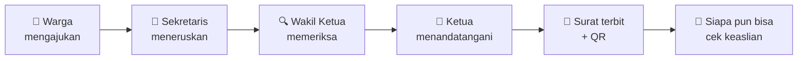
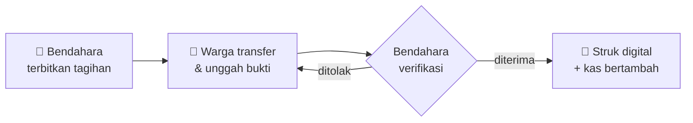
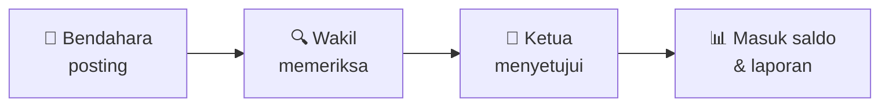

<div align="center">

# 🏘️ Portal Warga RT

**Satu website untuk seluruh urusan RT: kas yang terbuka, surat ber-QR, iuran online, pengumuman, aduan, hingga tombol darurat.**


[Keunggulan](#-keunggulan) · [Fitur](#-fitur-lengkap) · [Peran](#-peran--wewenang) · [Alur kerja](#-alur-kerja) · [Instalasi](#-instalasi) · [Struktur](#-struktur-folder)

</div>

---

## 🌟 Tentang

**Portal Warga RT** adalah aplikasi web untuk mendigitalkan administrasi Rukun Tetangga. Pengurus tidak lagi mencatat kas di buku, warga tidak perlu datang ke rumah Ketua RT hanya untuk surat pengantar, dan semua orang bisa melihat ke mana iuran dipakai.

Dibangun dengan **PHP murni + MySQL + Bootstrap 5**, sehingga ringan, mudah dipasang di XAMPP atau hosting murah, dan mudah dipelajari siapa pun yang ingin mengembangkannya.

---

## ✨ Keunggulan

| | Keunggulan | Artinya bagi RT Anda |
|---|---|---|
| 💰 | **Transparansi penuh** | Setiap warga bisa melihat saldo kas, mutasi, dan laporan keuangan yang siap cetak. |
| ✅ | **Persetujuan berjenjang** | Surat dan pengeluaran melewati Sekretaris → Wakil Ketua (pemeriksa) → Ketua (penanda tangan). Semua langkah tercatat. |
| 🔏 | **Surat anti-palsu** | Tanda tangan digital berupa kode QR. Siapa pun bisa mengecek keaslian surat dari halaman depan, cukup dengan kamera HP. |
| 🔄 | **Ganti pengurus tanpa repot** | Cukup ubah jabatan di satu akun. Hak akses, nama di kop surat, dan bagan pengurus ikut berganti. |
| 🚨 | **Tombol darurat** | Satu tombol mengirim peringatan merah bersirene ke layar semua pengurus dan warga. |
| 🧙 | **Pasang seperti WordPress** | Installer 5 langkah: cek server, hubungkan database, buat tabel, isi identitas RT, selesai. |
| 📴 | **Bisa offline** | Bootstrap, ikon, dan font bisa disimpan di server, jadi tetap jalan di jaringan lokal tanpa internet. |
| 🎨 | **Tampilan bisa diatur** | Tiga tema siap pakai, dan seluruh isi halaman depan bisa diubah dari menu admin tanpa menyentuh kode. |
| 📱 | **Ramah HP** | Responsif di layar ponsel; warga cukup membuka lewat browser, tanpa instal aplikasi. |
| 🛡️ | **Aman sejak awal** | Kata sandi di-hash, token CSRF di setiap formulir, akses berbasis jabatan, berkas sensitif terkunci. |

---

## 🧩 Fitur Lengkap

### 🏠 Halaman depan publik
- Profil **Ketua & Wakil Ketua RT** lengkap dengan foto dan sambutan
- Statistik jumlah KK, jiwa, dan blok
- Daftar layanan yang bisa diubah admin
- 🔎 **Pop-up Cek Surat** di kanan bawah: pindai QR dengan kamera, pilih foto QR, atau ketik nomor + tanggal surat. Hasil menampilkan data pemohon yang **disensor** (`Bu** Sa****`) demi privasi.

### 💰 Keuangan
- **Kas RT**: saldo, dana per alokasi (mis. saung, playground), laporan bulanan
- **Laporan Keuangan**: rincian pemasukan & pengeluaran per periode, rekap per kategori, saldo awal–akhir, **siap cetak/PDF** berkop surat dan kolom tanda tangan
- **Jenis tagihan**: IPL dan Kas RT bawaan, Bendahara bebas menambah jenis lain
- **Terbitkan tagihan wajib** ke seluruh keluarga dalam satu klik (tanpa tagihan ganda)
- **Bayar online manual**: warga transfer bank / e-wallet (BCA, Mandiri, BRI, BNI, GoPay, OVO, DANA, ShopeePay), unggah bukti, Bendahara memverifikasi, **struk digital** terbit otomatis

### ✉️ Surat menyurat
- **7 templat bawaan**: Pengantar RT/RW, Keterangan Domisili, Pengantar KTP/KK, Pengantar Kematian, SKTM, Pengantar Nikah/Kelahiran/Kepindahan, Keterangan Usaha
- **Editor A4** ala Word online untuk membuat templat baru atau surat manual, lengkap dengan variabel `{{nama}}`, `{{alamat}}`, `{{nomor_surat}}`, dll.
- **Kop surat** dengan logo kiri & kanan, serta moto RT di kaki surat
- Pilihan tanda tangan: **digital (QR)** atau **basah**
- Warga mengajukan surat dari rumah dan memantau statusnya
- Arsip surat dan halaman verifikasi publik

### 👥 Data warga
- Kepala keluarga, NIK/KK, blok & nomor rumah, jumlah anggota, status hunian, kontak darurat
- **Impor massal dari Excel**: setiap baris otomatis menjadi data warga + akun login
- Warga bisa memperbarui foto dan data dirinya sendiri

### 📣 Komunikasi
- **Pengumuman**: kegiatan, kerja bakti, siskamling, laporan keamanan
- **Notifikasi** 🔔 sesuai peran: tagihan baru, bukti bayar, surat menunggu tanda tangan, aduan, pengumuman
- **Chat pop-up** 💬: Grup Warga, Grup Pengurus, dan pesan pribadi
- **Aduan & aspirasi** dengan status *baru → diproses → selesai*
- **Tombol darurat** 🚨: kebakaran, pencurian, darurat medis, bencana, keributan

### 🏛️ Kepengurusan
- **Bagan struktur organisasi** otomatis: Ketua, Wakil, Sekretaris, Bendahara, 5 seksi, serta Tim Keamanan & Tim Kebersihan
- **Dasbor per jabatan** dengan daftar "Perlu tindakan Anda" dan grafik (KK per blok, status hunian, tagihan, arus kas)

### ⚙️ Administrasi
- Pengaturan situs: nama, logo, favicon, dan seluruh teks halaman depan
- **3 tema**: Teal Segar, Biru Resmi, Hangat Terakota (dengan pratinjau)
- Manajemen akun & jabatan, unduh aset offline

---

## 🧑‍🤝‍🧑 Peran & Wewenang

| Peran | Yang bisa dilakukan |
|---|---|
| 🛠️ **Administrator** | Semua wewenang, akun & jabatan, impor Excel, pengaturan situs, tema, aset offline |
| 👑 **Ketua RT** | Penanda tangan (*signer*) surat, menyetujui pengeluaran kas |
| 🔍 **Wakil Ketua** | Pemeriksa (*checker*) surat dan pengeluaran sebelum ke Ketua |
| 📝 **Sekretaris** | Membuat surat manual, meneruskan pengajuan warga, mengelola templat & data warga |
| 💼 **Bendahara** | Menerbitkan tagihan, mengatur jenis tagihan, memverifikasi bukti bayar, memposting pengeluaran |
| 🧹 **Seksi & Tim** | Tampil di struktur organisasi; akses sebagai warga |
| 🏡 **Warga** | Membayar tagihan, mengajukan surat, aduan, chat, tombol darurat, melihat kas & laporan |

> Jabatan inti (Ketua, Wakil, Sekretaris, Wakil Sekretaris, Bendahara) hanya dipegang satu orang. Saat jabatan diberikan ke akun baru, pemegang lama otomatis kembali menjadi warga.

---

## 🔁 Alur Kerja

**Pengajuan surat warga**



**Iuran bulanan**



**Pengeluaran kas**



---

## 🚀 Instalasi

### Persyaratan
- PHP **7.4+** dengan ekstensi `pdo_mysql` dan `mysqli` (ekstensi `zip` untuk impor Excel)
- MySQL atau MariaDB
- XAMPP / Laragon (lokal) atau hosting PHP biasa

### Pasang baru
1. Salin seluruh isi folder ke `htdocs/websitert` (lokal) atau `public_html` (hosting).
2. Buka `http://localhost/websitert/`, otomatis diarahkan ke installer.
3. Ikuti 5 langkah:

   | Langkah | Isi |
   |---|---|
   | 1️⃣ Persyaratan | Cek server, opsional unduh aset offline |
   | 2️⃣ Database | Host, port, nama database, username, kata sandi |
   | 3️⃣ Tabel | Buat tabel, boleh dengan data contoh |
   | 4️⃣ Situs & admin | Nama website, RT/RW, wilayah, logo, favicon, tema, akun admin |
   | 5️⃣ Selesai | Installer terkunci, hapus `install.php` dengan satu klik |

### Memperbarui dari versi lama
Timpa berkas (jangan hapus database), buka `install.php`, lalu pilih **Pakai data yang ada**. Struktur tabel diperbarui otomatis.

### Coba di GitHub Codespaces
Klik **Code → Codespaces → Create codespace**. PHP, MariaDB, dan data contoh menyala otomatis; buka port **8080**.

### Akun contoh *(hanya jika memilih data contoh)*

| Username | Kata sandi | Jabatan |
|---|---|---|
| `rt` | `rt12345` | Ketua RT |
| `wakil` | `wakil123` | Wakil Ketua |
| `sekretaris` | `sekretaris123` | Sekretaris |
| `bendahara` | `bendahara123` | Bendahara |
| `budi` | `warga123` | Warga |

> ⚠️ Hapus atau ganti kata sandi akun contoh sebelum website dipakai warga.

---

## 📁 Struktur Folder

```
websitert/
├── install.php          # installer 5 langkah
├── database.sql         # struktur tabel + templat surat (+ data contoh opsional)
├── index.php            # pintu masuk otomatis
├── README.md
└── app/                 # seluruh aplikasi
    ├── config.php       # koneksi, hak akses, fungsi bersama
    ├── aset.php         # pemuat aset lokal/CDN (mode offline)
    ├── api.php          # notifikasi, darurat, chat (JSON)
    ├── cek.php          # cek keaslian surat (publik)
    ├── assets/          # CSS, JS, dan aset offline (vendor/)
    ├── sql/             # pembaruan database antarversi
    └── uploads/         # logo, foto, bukti bayar (terlindungi)
```

---

## 🛠️ Teknologi

| Bagian | Yang dipakai |
|---|---|
| Server | PHP murni (tanpa framework), PDO, MySQL/MariaDB |
| Tampilan | Bootstrap 5.3.8, Bootstrap Icons 1.13.2, Plus Jakarta Sans / Inter / Fraunces |
| Grafik & QR | Chart.js, QRCode.js, html5-qrcode |
| Pengembangan | GitHub Codespaces (Docker + MariaDB) |

## 🔐 Keamanan

- Kata sandi disimpan dengan `password_hash` (bcrypt); akun impor diminta mengganti sandi saat pertama masuk
- Token **CSRF** di setiap formulir dan permintaan API
- Hak akses dibaca ulang dari database setiap halaman dibuka
- Isi surat dibersihkan dari skrip berbahaya; unggahan divalidasi jenis & ukurannya
- `config.local.php`, berkas SQL, dan bukti bayar tidak bisa diakses langsung dari browser
- Data di halaman verifikasi publik disensor sebagian

## ⚠️ Batasan Saat Ini

- Pembayaran masih **manual** (unggah bukti); belum terhubung ke payment gateway
- Notifikasi, chat, dan peringatan darurat hanya sampai ke perangkat yang **sedang membuka website**
- Pemindai QR membutuhkan **https** atau **localhost**

## 🗺️ Rencana Pengembangan

- [ ] Integrasi payment gateway (Midtrans / Xendit)
- [ ] Notifikasi WhatsApp dan push ke HP
- [ ] Unggah foto pada aduan
- [ ] Migrasi ke Bootstrap 6 setelah rilis stabil

---

<div align="center">

Dibuat untuk lingkungan yang **rukun, aman, dan guyub** 🤝

</div>
